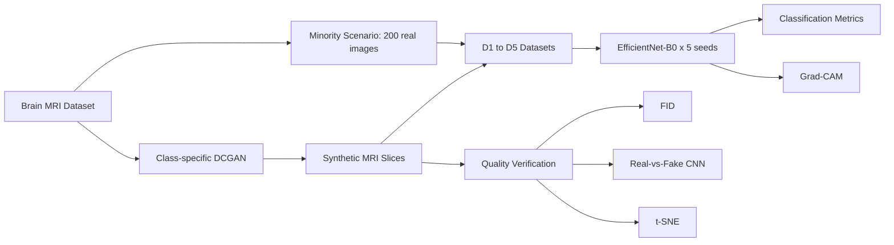

---

## 👨‍💻 About Me

- 🔬 **Research focus:** Medical imaging, synthetic data reliability, and explainable deep learning
- 🔭 **Currently working on:** [A Controlled Augmentation Framework for GAN Quality in Medical AI](https://github.com/Shadhai/brain_tumor_gan_project) (technical report, under review)
- 🧠 **Core belief:** a metric going up is not the same as a model being right. I verify *why* something works
- 🏗️ **Also build:** production-style backends (Spring Boot, JWT, role-based APIs) and MERN full-stack apps
- 🌱 **Currently learning:** AI agents and intelligent systems
- 💬 **Ask me about:** GAN evaluation, class imbalance, Grad-CAM, Spring Boot, React
- ⚡ **Fun fact:** my GAN experiments run on a single RTX 3050, and I've learned that rigor matters more than raw compute

---

## 🔬 Research

### 🧪 A Controlled Augmentation Framework Reveals the Critical Role of GAN Quality

> A reproducibility-focused study on minority brain tumor detection in MRI

**The problem:** GANs are widely proposed to fix class imbalance in medical imaging, but most studies only check whether *classification improves* and never ask whether the synthetic images are *medically realistic*.

**The study:** The pituitary tumor class was cut to just **200 real MRI images** to simulate a rare condition. A class-specific **DCGAN** generated synthetic slices at increasing ratios, and an **EfficientNet-B0** classifier was trained on five datasets (D1 to D5) across **five random seeds**.

**The finding:** recall improved, but the GAN had not learned the real distribution.

| Evidence | Result | What it means |
|:---|:---|:---|
| Pituitary recall (val) | 0.880 → **0.984** with GAN data | Classification looks like a clear win |
| Pituitary recall (val), traditional aug | **0.994** | Simple augmentation matched or beat the GAN |
| FID, GAN sets | 231 to 235 | Very poor realism |
| FID, traditional aug | 113 | Better, but still imperfect |
| Real-vs-fake CNN | **99.8%** accuracy | Synthetic images are trivially separable |
| t-SNE | Disjoint clusters | No overlap with the real data manifold |

> **Takeaway:** performance improvement alone is *not* evidence of successful medical image generation. The repo proposes a reusable **multi-modal GAN verification protocol**: FID + real-vs-fake CNN + t-SNE + Grad-CAM + multi-seed statistics.

### 🧭 Research Interests

| Area | What I care about |
|:---|:---|
| 🧠 **Medical AI Safety** | Making sure models are trustworthy before they are accurate |
| 🎨 **Generative Models** | Evaluating whether synthetic data is actually realistic |
| 🔍 **Explainable AI** | Grad-CAM and attention validation against anatomy |
| ♻️ **Reproducibility** | Multi-seed statistics, open code, single-command pipelines |
| ⚖️ **Class Imbalance** | Rare-disease detection with limited real data |

---

## 🛠️ Tech Stack

### 🤖 Machine Learning & Research

### 💬 Languages

### ⚛️ Frontend

### 🔧 Backend

### 🗄️ Database

### 🧰 Tools & DevOps

---

## 📊 GitHub Stats

  
  

  

---

## 📈 Contribution Activity

  

---

## 🏆 GitHub Trophies

  

---

## 🚀 Featured Projects

### 🧠 [Brain Tumor GAN Project](https://github.com/Shadhai/brain_tumor_gan_project) ⭐ *Flagship research*

> Controlled study of GAN-based augmentation for rare brain tumor detection, with a multi-modal verification protocol for synthetic medical images.

**What it does:** Trains a class-specific DCGAN on pituitary MRI slices, builds five controlled datasets (D1 to D5), and evaluates an EfficientNet-B0 classifier across five seeds. It then checks GAN realism with FID, a real-vs-fake CNN, t-SNE, and Grad-CAM, and shows that recall gains can occur even when the generator fails.  
**Tech used:** `Python` `PyTorch` `DCGAN` `EfficientNet-B0` `Grad-CAM` `FID` `t-SNE`

---

### 🚗 [Ultimate Car Rental Backend](https://github.com/Shadhai/Ultimate_Car_Rental_Backend-Spring-Boot-)

> Enterprise-ready Spring Boot backend for a multi-role vehicle rental platform with secure authentication, payment processing, and analytics.

**What it does:** A vehicle rental management system with 4 roles (Admin, Local Head, Driver, Customer), each with scoped API access. Covers the full rental lifecycle from booking to driver payout, with JWT security, analytics dashboards, and Swagger docs.  
**Tech used:** `Java 17` `Spring Boot` `Spring Security` `JPA/Hibernate` `MySQL` `Swagger`

---

### 🍔 [Food Delivery App](https://github.com/Shadhai/fooddelivery)

> Full-stack MERN food delivery platform with user authentication, order tracking, and an admin dashboard.

**What it does:** A food ordering experience on the MERN stack: React + Vite frontend, Node.js/Express backend, MongoDB persistence. Supports menu browsing, cart management, and order placement.  
**Tech used:** `MongoDB` `Express.js` `React.js` `Node.js` `Vite`

---

### 🏷️ [Online Auction Platform](https://github.com/Shadhai/auction)

> A JavaScript auction platform with bid management, secure login, and auction scheduling.

**What it does:** Users create auctions, place bids, and track winning status. Built with plain JavaScript and CSS for a lightweight, dependency-free experience.  
**Tech used:** `JavaScript` `CSS3` `HTML5`

---

### ☕ [Spring Boot AC](https://github.com/Shadhai/springbootac)

> Spring Boot practice project exploring Java backend patterns, REST APIs, and enterprise architecture.

**What it does:** A sandbox for RESTful API patterns, JPA repositories, and Spring configuration, the proving ground behind the car rental system.  
**Tech used:** `Java` `Spring Boot` `Maven`

---

### ⚙️ [CI/CD Pipeline](https://github.com/Shadhai/ci-cd)

> Continuous Integration and Deployment experiments with automated workflows.

**What it does:** Explores CI/CD with GitHub Actions: automated build, test, and deployment workflows. This is the engineering discipline I bring to ML experiments too.  
**Tech used:** `GitHub Actions` `YAML` `DevOps`

---

## 📁 All Repositories

| Repository | Description | Domain | Language | Stars |
|:---|:---|:---|:---|:---:|
| [brain_tumor_gan_project](https://github.com/Shadhai/brain_tumor_gan_project) | GAN augmentation quality study for minority brain tumor detection | 🔬 ML Research |  | ⭐ 1 |
| [Ultimate_Car_Rental_Backend-Spring-Boot-](https://github.com/Shadhai/Ultimate_Car_Rental_Backend-Spring-Boot-) | Enterprise Spring Boot backend for multi-role vehicle rental | 🔧 Backend |  | ⭐ 3 |
| [fooddelivery](https://github.com/Shadhai/fooddelivery) | Full-stack MERN food delivery platform | 🌐 Full-Stack |  | ⭐ 0 |
| [Food](https://github.com/Shadhai/Food) | Food-themed frontend UI project | ⚛️ Frontend |  | ⭐ 0 |
| [auction](https://github.com/Shadhai/auction) | Online auction platform | 🌐 Full-Stack |  | ⭐ 0 |
| [springbootac](https://github.com/Shadhai/springbootac) | Spring Boot REST API sandbox and practice repo | 🔧 Backend |  | ⭐ 0 |
| [ci-cd](https://github.com/Shadhai/ci-cd) | GitHub Actions CI/CD pipeline experiments | ⚙️ DevOps |  | ⭐ 0 |
| [Shadhai](https://github.com/Shadhai/Shadhai) | 👤 Profile README repository | 📝 Meta |  | ⭐ 0 |

> 📦 **48 public repositories** in total. Explore them all at [github.com/Shadhai](https://github.com/Shadhai?tab=repositories)

---

## 🐍 Contribution Snake

  

<!-- To enable the snake: follow https://github.com/Platane/snk to set up the GitHub Action -->

---

## 🤝 Connect With Me

 

> 💡 *"Reproducibility is not optional in medical AI."*

---

